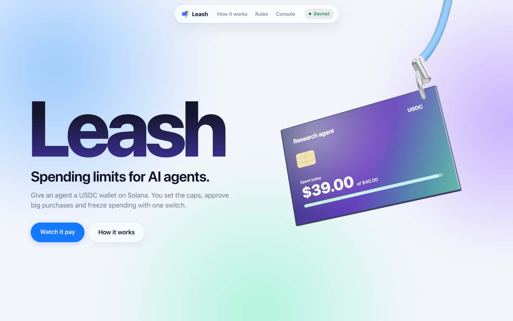
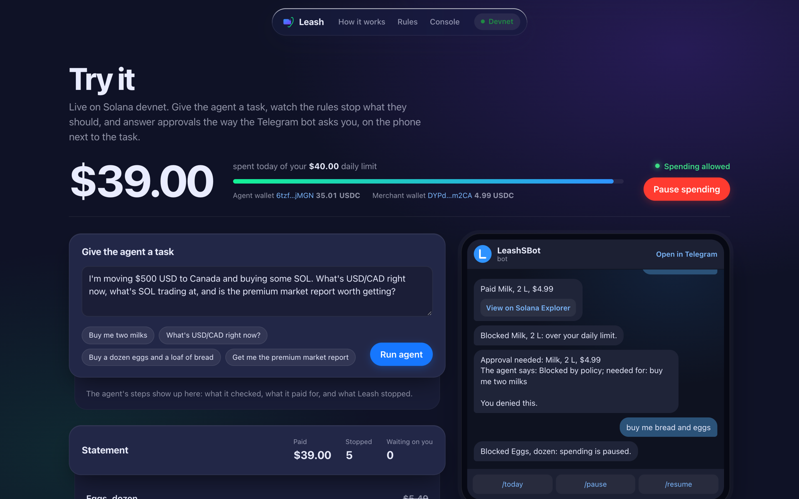
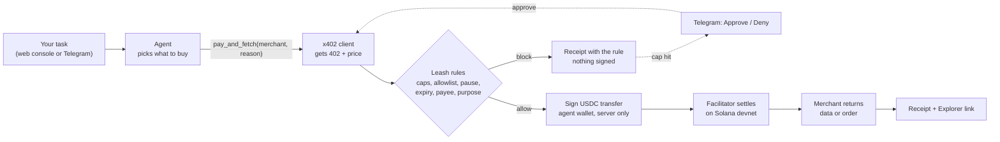

<div align="center">


# Leash

**Spending limits for AI agents.**

Give an agent a USDC wallet on Solana. You set the caps, approve big purchases from Telegram, and freeze spending with one switch.

[](https://leash.up.railway.app)
[](https://t.me/LeashSBot)


UBC Hackathon 2026 · Track 1: Agentic Payments · Best use of Solana



</div>

## Why

An agent that can pay for things is useful right up until it buys the wrong thing, or buys it forty times. Most agent wallets today are a private key and a hope. Leash puts the owner's rules between the agent and the money: every payment is checked before it is signed, and anything over the line either stops or waits for the owner's yes.

## What it does

- **Hard caps.** Per purchase, per day and per merchant. The agent can't sign past them.
- **Approvals on your phone.** When a cap blocks something the task needs, @LeashSBot sends you the item, the price and the agent's reason with Approve and Deny buttons.
- **One switch to freeze it.** Pause from the console or send `/pause` in Telegram. Nothing moves until you resume.
- **Scam protection.** An allowlist of merchants, a card expiry date, a payee check against the merchant's real wallet, and a purpose check that blocks purchases the task never asked for. That last one stops a merchant's reply from talking the agent into buying something else.
- **A statement you can read.** Every payment and every block is a receipt with the rule that fired and a Solana Explorer link for settled payments.



## How a payment works



1. The agent decides what to buy and calls `pay_and_fetch` with a merchant id and a one-line reason. It sees tool results only, never keys.
2. The x402 client requests the merchant URL and gets a 402 with the price and payee.
3. Before anything is signed, the rule engine checks the payment against the owner's rules and today's spend. The first rule that fails wins, and it is written to the statement.
4. If allowed, the client signs a devnet USDC transfer from the agent wallet to the merchant and retries with the payment header.
5. The facilitator verifies and settles the transfer, and the merchant answers. The facilitator runs inside the app with its own fee-payer wallet, because the public x402.org facilitator was being rate-limited during the build.

An approval lifts the caps for that one payment. The allowlist, pause, expiry, payee and purpose checks still apply.

## Merchants

Everything is sold over x402 from the same app, so the demo runs on its own. Nothing ships; shop purchases return an order confirmation.

| Merchant | Price | What you get |
|---|---|---|
| FX Rates | $0.01 | Live USD exchange rates (open.er-api.com) |
| SOL Price | $0.02 | Live SOL/USD and 24h change (CoinGecko) |
| Premium Market Report | $20.00 | Priced to trip the per-purchase cap |
| USB-C Cable, 2 m | $8.99 | Leash Shop |
| Coffee Beans, 1 kg | $14.50 | Leash Shop |
| Gift Card, $25 | $25.00 | Leash Shop, over the per-purchase cap |
| Milk, 2 L | $4.99 | Leash Shop groceries |
| Eggs, dozen | $5.49 | Leash Shop groceries |
| Bread, 1 loaf | $3.99 | Leash Shop groceries |

Default rules: $15 per purchase, $40 per day, $20 per merchant, purpose check on, card valid for 7 days.

## Telegram bot

[@LeashSBot](https://t.me/LeashSBot) is a second front end to the same account. The first chat to message it becomes the owner, and it ignores everyone else.

- Send a task in plain words ("buy me two milks") and the bot reports each payment or block as it happens, with Explorer buttons.
- Approval requests from any task, web or Telegram, arrive with Approve and Deny buttons. Answering removes the buttons so a request can't be paid twice.
- `/today` shows spend against the daily limit. `/pause` and `/resume` flip the switch.

It uses long polling, so it works on localhost with no public URL.

## The agent

With `ANTHROPIC_API_KEY` set, Claude plans the purchases in a tool loop and a second Claude call does the purpose check. The live demo runs without a key: a scripted planner picks merchants from keywords in the task (and understands quantities like "a dozen" or "two") and calls the same tools, so payments, rule checks and receipts are all real. The scripted planner also follows a merchant's `next_purchase` hint on purpose, to show the purpose check catching it.

## Devnet addresses

| Wallet | Address |
|---|---|
| Agent (payer) | [`6tzfXNJHE8XvjQWPUksZtkypiTaEoqTM1HaDdLX7jMGN`](https://explorer.solana.com/address/6tzfXNJHE8XvjQWPUksZtkypiTaEoqTM1HaDdLX7jMGN?cluster=devnet) |
| Merchant (payee) | [`DYPdj3y9MSSfTGZySPBmN5GhdbFUVYRxhoK4aqbHm2CA`](https://explorer.solana.com/address/DYPdj3y9MSSfTGZySPBmN5GhdbFUVYRxhoK4aqbHm2CA?cluster=devnet) |
| Facilitator fee payer | `93k3PRapsMuAcemY1zesqHgsopd7ZKy7bf4mdQzzVCMT` |
| USDC mint (Circle devnet) | `4zMMC9srt5Ri5X14GAgXhaHii3GnPAEERYPJgZJDncDU` |

There is no custom on-chain program. Payments are SPL token transfers settled through x402.

## Run it

```bash
npm install
node scripts/gen-wallets.mjs                               # once: agent + merchant wallets into .env.local
# fund the agent wallet with devnet SOL and USDC, then:
node --env-file=.env.local scripts/setup-facilitator.mjs   # once: creates and funds the fee payer
npm run dev                                                # http://localhost:3000
node --env-file=.env.local scripts/refill.mjs              # top the agent back up between demos
```

`.env.local` (see `.env.example`):

| Variable | What |
|---|---|
| `SVM_PRIVATE_KEY`, `AGENT_ADDRESS` | Agent wallet, written by `gen-wallets.mjs`. Fund with devnet SOL (faucet.solana.com) and USDC (faucet.circle.com) |
| `MERCHANT_PAY_TO` | Merchant wallet address |
| `FACILITATOR_PRIVATE_KEY`, `FACILITATOR_ADDRESS` | Written by the setup script |
| `SOLANA_RPC_URL` | Defaults to `https://api.devnet.solana.com` |
| `TELEGRAM_BOT_TOKEN` | Optional. Turns on the bot. Run one copy at a time, or the two pollers fight |
| `ANTHROPIC_API_KEY` | Optional. Empty means the scripted planner and keyword purpose check |
| `FACILITATOR_URL` | Optional. Use a remote x402 facilitator instead of the built-in one |

## Code map

| Path | Role |
|---|---|
| `src/lib/policy.ts` | Rule engine: a pure function from (rules, history, payment) to allow or block |
| `src/lib/guard.ts` | Purpose check: does this payment serve the owner's task? Never sees merchant replies |
| `src/lib/payments.ts` | x402 client with the rule hook; the only code that can move the agent's money |
| `src/lib/x402-server.ts` | Merchant paywall and the in-process facilitator |
| `src/lib/shop.ts`, `merchants.ts` | Leash Shop products and the merchant catalog |
| `src/lib/agent.ts` | Claude tool loop and the scripted planner |
| `src/lib/approvals.ts` | Approve or deny, shared by the console and the bot |
| `src/lib/telegram.ts` | @LeashSBot: tasks, approvals, `/today`, `/pause`, `/resume` |
| `src/lib/store.ts` | Rules and receipts (JSON file in `data/`) |
| `src/app/page.tsx`, `sections.tsx`, `scene.tsx` | Landing page and the 3D card on a rope |
| `src/app/console.tsx` | The live console, statement and phone |
| `src/app/api/*` | `agent` (streamed NDJSON), `approval`, `pay`, `policy`, `ledger`, `wallets`, `merchant/*`, `shop/*` |

## Limits and next steps

- The rules run on our server, which holds the key. Moving them on-chain (a token-account delegate or a small program with spending limits) would mean the owner doesn't have to trust the server either.
- The store is a JSON file. Multiple users need a real database and one wallet per agent.
- Next: team accounts with a budget per agent, real merchants that accept x402, and approval rules like "anything under $5 from a known merchant is fine".
